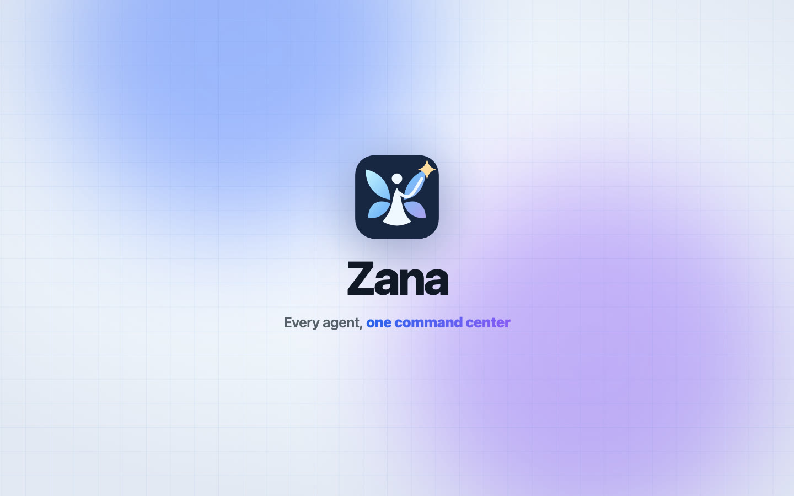

  

<h1 align="center">Zana</h1>

  <strong>The agentic platform for your coding agents.</strong>

See and manage Codex, Claude Code, Cursor, OpenCode, Pi, and other agent
harnesses in one place. Give your agents a common interface to build tools and
workflows on, and share what you create with colleagues through plugins.

  <a href="https://github.com/salesforce/zana/releases/latest"><strong>Download Zana</strong></a> ·
  <a href="#watch-the-tour">Watch the tour</a> ·
  <a href="https://zana-ide.com/docs/">Documentation</a> ·
  <a href="https://zana-ide.com/">Try Agent City ↗</a>

  Free and open source · macOS (Apple Silicon &amp; Intel) · Windows x64

## All your harnesses, one place

Run your preferred coding agents across projects and machines, in structured
conversations or native CLI sessions. See which agents are working, idle, or
waiting for you. Answer their questions, review their diffs and reports, and
keep useful findings in your project Library.

## Watch the tour

See Zana in action: start a task, follow your agents, and review the result.

https://github.com/user-attachments/assets/e740fdf8-50f7-4823-b956-976904ff364e

[Watch with captions on the website →](https://zana-ide.com/#demo)

## One interface for agents to build on

Zana gives your agents a shared platform for working with projects,
conversations, files, and tools. The CLI, agent tools, and
[Control SDK](docs/control-sdk.md) connect to the same product services, so
agents and scripts can work with Zana through a common interface.

Build on that foundation with the
[`@zana-ai/zcc-plugin-sdk`](packages/plugin-sdk). Plugins can bring together
panels, agent tools, skills, MCP integrations, and CLI commands—giving you and
your agents a place to build the workflows your team needs.

## Build tools. Share them with your team.

Package your tools and workflows as plugins and share them with colleagues
through Git, npm, or a marketplace. Your team can install and reuse them in
Zana across supported harnesses.

Zana Connect brings your work online: access your Zana over the internet and
open private web previews of the apps your agents build from another device
signed in to your account.

[Browse plugins](https://zana-ide.com/marketplace/) ·
[Build a plugin](docs/extensions-quickstart.md) ·
[Remote access](docs/mobile-connect.md) ·
[Shared previews](docs/shared-previews.md)

## Get Zana

**[Download for macOS or Windows →](https://github.com/salesforce/zana/releases/latest)**

Bring your coding-agent CLI, installed and authenticated, plus **Node.js 20+**
and **Git**. Remote execution hosts and source development use **Node.js 22+**.

Setup, daily workflows, architecture, and development instructions live in the
[documentation](https://zana-ide.com/docs/). To contribute to Zana itself, see
[CONTRIBUTING.md](CONTRIBUTING.md).

## Open source, yours to shape

Zana is **[MIT-licensed](LICENSE.txt)**. Fork it, add your own integrations,
and build around the tools and environments your team uses. Contributions to
code, documentation, tests, and issue reports are welcome.

Zana’s architecture builds on the work of **[bb](https://github.com/get-bb/bb)**.
We also draw inspiration from Cursor, Codex, and Claude Code.

  <a href="https://zana-ide.com/">Website</a> ·
  <a href="https://github.com/salesforce/zana/issues">Issues</a> ·
  <a href="CONTRIBUTING.md">Contributing</a> ·
  <a href="SECURITY.md">Security</a> ·
  <a href="CODE_OF_CONDUCT.md">Code of conduct</a>

