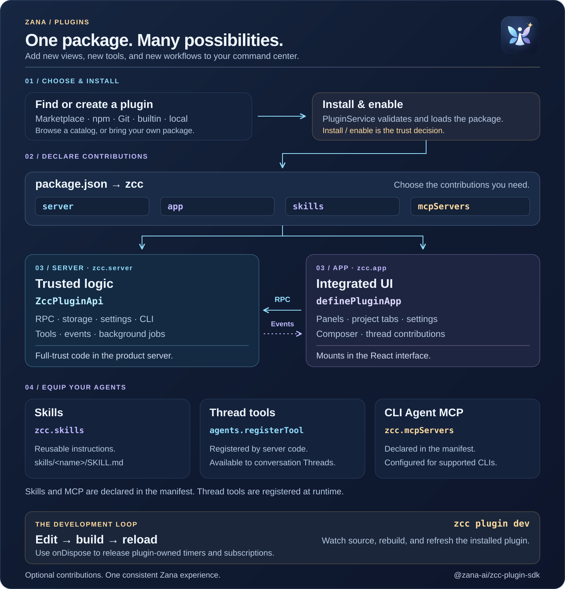
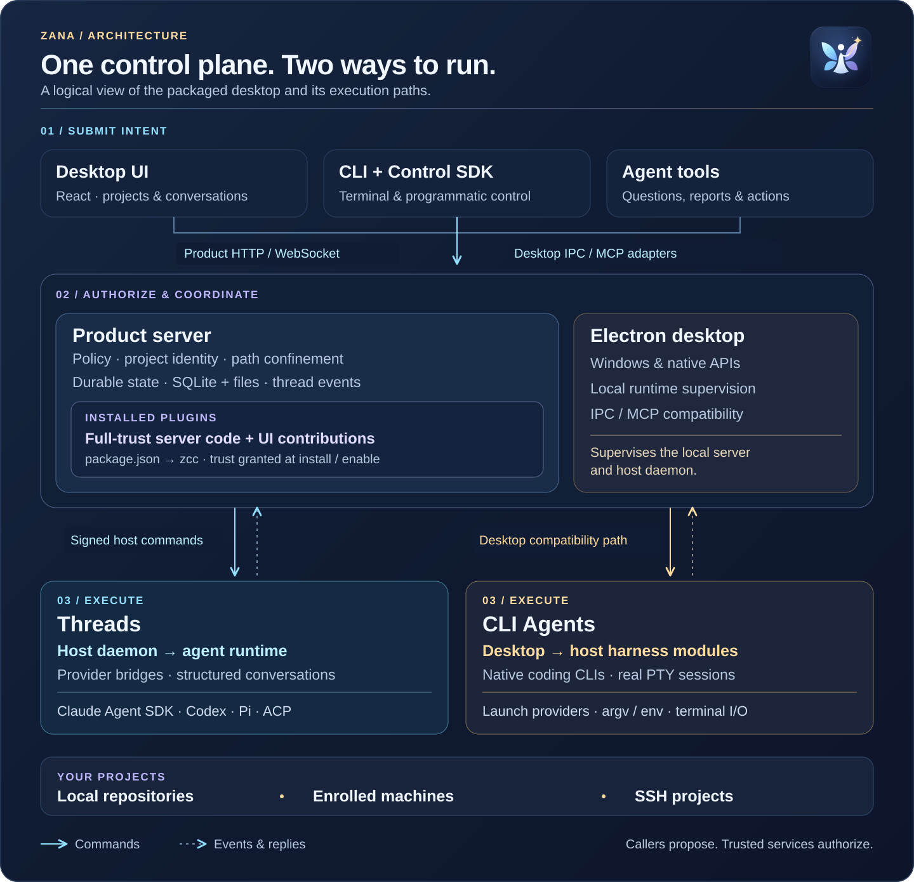

<p align="center">
  
</p>

<h1 align="center">Zana</h1>

<p align="center">
  <strong>Your agents. Your projects. All together.</strong><br>
  Run the coding agents you already use. Follow their work and step in when they need you.
</p>

<p align="center">
  <a href="https://github.com/salesforce/zana/releases/latest"><strong>Download Zana</strong></a> ·
  <a href="#watch-the-tour">Watch the tour</a> ·
  <a href="https://zana-ide.com/">Try Agent City ↗</a>
</p>

<p align="center">
  <sub>Free and open source · macOS (Apple Silicon &amp; Intel) · Windows x64</sub>
</p>

## Keep your work moving

- **Your agents, together.** Use Claude Code, Codex, Cursor, OpenCode, and Pi in structured conversations or native CLI sessions across your projects.
- **Know what needs you.** See working, idle, and waiting agents. Answer questions from your Inbox and send the reply back to the agent.
- **Review the result.** Read reports, diagrams, and diffs beside the conversation. Keep useful findings in your project Library.

## Watch the tour

Start a task, follow your agents, and review the result in this 80-second recording of the app.

https://github.com/user-attachments/assets/e740fdf8-50f7-4823-b956-976904ff364e

[Watch with captions on the website →](https://zana-ide.com/#demo)

## Get started

**[Download for macOS or Windows →](https://github.com/salesforce/zana/releases/latest)**

1. Install the `.dmg` for your Mac (**Apple Silicon** or **Intel**) or the **Windows x64** installer.
2. Add your first project: a local folder, an enrolled machine, or an SSH project.
3. Open **New Chat**, choose a Thread, CLI Agent, or Team, and give it a task.

You’ll need **Node.js 20+**, **Git**, and your chosen coding-agent CLI installed
and authenticated. Remote execution hosts and source development use **Node.js 22+**.
macOS releases are signed and notarized. The app checks for updates and applies
downloaded updates when you quit.

[First-run guide](docs/getting-started.md) ·
[Daily workflows](docs/using-zana.md) ·
[Multiple machines](docs/multiple-devices.md)

## Make it yours

Agent City is a plugin. Add the panels, tools, skills, and integrations that fit
your work—or build your own with the [`@zana-ai/zcc-plugin-sdk`](packages/plugin-sdk).

**Zana for Slack comes pre-installed.** Open **Plugins → Zana for Slack → Configuration** to link your account and connect Project channels. [Slack setup and controls](plugins/slack-bridge-2ff2/README.md).

[Browse plugins](https://zana-ide.com/marketplace/) ·
[Build your first plugin](docs/extensions-quickstart.md) ·
[SDK reference](docs/extensions-sdk-reference.md)

<details>
<summary><strong>How plugins work</strong></summary>

Add panels, project tabs, agent tools, skills, MCP servers, settings, and CLI
commands through **Plugins**. Browse the in-app catalog or build your own
TypeScript package with the [`@zana-ai/zcc-plugin-sdk`](packages/plugin-sdk).

A plugin’s `package.json` declares the pieces it contributes: **server logic**,
**interface elements**, and **agent capabilities**. Zana loads those pieces
and connects them through the SDK.

[](docs/assets/zana-plugins.svg)

```bash
zcc plugin new hello --app
cd zcc-plugin-hello
zcc plugin install .
zcc plugin dev
```

You can also choose **Create** in **Plugins → Browse** to start inside Zana.
The development loop watches your source, rebuilds the UI, and reloads the
installed plugin as you edit.

[How plugins work](docs/extensions.md) ·
[Plugin quickstart](docs/extensions-quickstart.md) ·
[Authoring guide](docs/extensions-authoring.md) ·
[SDK reference](docs/extensions-sdk-reference.md)

</details>

<details>
<summary><strong>Use Zana from your terminal</strong></summary>

The `zcc` CLI and [Control SDK](docs/control-sdk.md) let you operate the running
app from scripts and your terminal. With `zcc` on your `PATH`:

```bash
# Find a registered project
zcc project list

# Start a Thread in that project
zcc thread spawn --project <project-id> --prompt "Review the current diff"

# See your running Threads
zcc thread list
```

Live commands use the app’s authenticated control APIs. Selected commands,
including `zcc guide`, plugin scaffolding, and Inbox file reads, also work
offline. See the [CLI reference](docs/cli.md) for installation and all commands.

</details>

## How Zana fits together

The desktop app, CLI, and agent tools connect through shared product services.
Execution runs on your machines; plugins extend the app.

[Architecture guide](docs/architecture/high-level-architecture.md) ·
[Runtime boundaries](docs/architecture/runtime-monorepo.md)

<details>
<summary><strong>Explore the architecture</strong></summary>

The desktop UI, `zcc` CLI, and agent tools connect to Zana’s product services.
The **product server** owns policy, projects, thread state, and the plugin
host. **Host execution** runs the authorized work on your machines. Electron
provides the desktop shell, supervises the local runtime, and retains
compatibility adapters for native and CLI Agent operations.

[](docs/assets/zana-architecture.svg)

| Execution surface | How it runs |
| :--- | :--- |
| **Threads** | Structured conversations through the host daemon, agent runtime, and provider bridges: Claude Agent SDK, Codex app-server, Pi SDK, and ACP. |
| **CLI Agents** | Native coding CLIs in real PTYs, using the desktop launch path and host harness modules. Shell terminals use PTYs too. |

The renderer supplies intent; trusted server and desktop services authorize
operations and confine paths. Installed plugins run **full-trust inside the
product server** and can contribute UI. Install and enable are the trust
decisions; plugins are not sandboxed guests.

[Architecture guide](docs/architecture/high-level-architecture.md) ·
[Runtime boundaries](docs/architecture/runtime-monorepo.md) ·
[Editable diagram and exports](docs/assets/README.md)

</details>

## Develop Zana

Use **Node.js 22+** and the **pnpm version pinned in `package.json`**.

```bash
git clone https://github.com/salesforce/zana.git
cd zana
pnpm install
pnpm run rebuild
pnpm dev
```

Development uses `~/.zcc-dev` and port `8781`, so it can run alongside your
installed app. The pre-dev step builds the CLI and seeds bundled plugins.

<details>
<summary><strong>Packaged builds and CLI connections</strong></summary>

To build and run the packaged desktop app, quit any other Zana instance using
`~/.zcc` first:

```bash
pnpm dist
pnpm start
```

`pnpm start` opens the built app from `dist/`; it does not rebuild.
`pnpm preview` runs unpackaged production Electron from `out/`.
`pnpm dev:prod` points development at `~/.zcc` on port `8780`; quit the
installed app before using it. Use that command rather than `pnpm dev --prod`,
which is pnpm’s production-dependencies flag.

Build and run the CLI directly from this checkout:

```bash
pnpm build:cli
node packages/cli/dist/bin/zcc.js project list
```

To target the isolated development app:

```bash
ZCC_DATA_DIR="$HOME/.zcc-dev" ZCC_SERVER_URL=http://127.0.0.1:8781 \
  node packages/cli/dist/bin/zcc.js project list
```

Without overrides, the CLI targets the installed app’s data in `~/.zcc`
and product API on port `8780`.

</details>

<details>
<summary><strong>Repository map, checks, and optional review</strong></summary>

### Repository map
| Path | Responsibility |
| :--- | :--- |
| [`apps/app`](apps/app) | React interface: projects, conversations, fleet views, and plugin surfaces. |
| [`apps/server`](apps/server) | Product APIs, policy, durable state, and the plugin host. |
| [`apps/host-daemon`](apps/host-daemon) | Agent execution, provider bridges, PTY harnesses, and host filesystem operations. |
| [`apps/desktop`](apps/desktop) | Electron shell, native integration, runtime supervision, and compatibility IPC. |
| [`packages`](packages) | Shared contracts, agent runtime, SDKs, CLI, and UI primitives. |
| [`plugins`](plugins) | First-party plugins and provider integrations. |
| [`website`](website) | Public website, documentation, and marketplace. |

### Checks

```bash
pnpm typecheck
pnpm test
pnpm build
pnpm test:e2e
```

See [CONTRIBUTING.md](CONTRIBUTING.md) for the contribution workflow and
[e2e/README.md](e2e/README.md) for end-to-end testing.

### Optional pre-push AI review (internal developers)

Authorized internal developers can opt in to an advisory
[TinyNod](https://git.soma.salesforce.com/cc-oms/pr-reviewer) review that runs
during `git push`. It is off by default, never blocks a push, and never runs in
public CI.

```bash
git config --local zana.tinynod.enabled true    # opt in (set false to opt out)
TINYNOD_SKIP_HOOK=1 git push                    # skip TinyNod for one push
```

Setup for DevBar / AI Suite users and everyone else, reading results, having an
AI fix findings, and troubleshooting are in
[docs/tinynod-local-review.md](docs/tinynod-local-review.md).

</details>

## Open source, yours to shape

Zana is **[MIT-licensed](LICENSE.txt)**. Fork it, adapt the interface, add your
own integrations, and build around the tools and environments your team uses.
Contributions to code, documentation, tests, and issue reports are welcome.

Zana’s architecture builds on the work of **[bb](https://github.com/get-bb/bb)**.
We also draw inspiration from Cursor, Codex, and Claude Code.

<p align="center">
  <a href="https://zana-ide.com/">Website</a> ·
  <a href="https://github.com/salesforce/zana/issues">Issues</a> ·
  <a href="CONTRIBUTING.md">Contributing</a> ·
  <a href="SECURITY.md">Security</a> ·
  <a href="CODE_OF_CONDUCT.md">Code of conduct</a>
</p>
